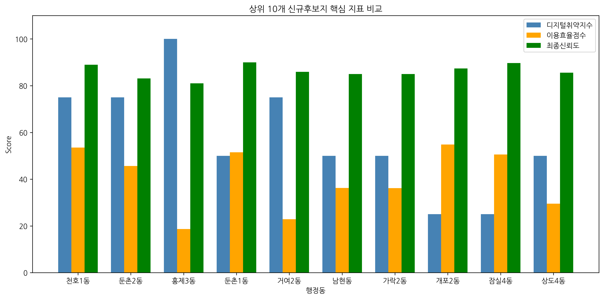

# 디지털취약지수와 신뢰도 평가 기반 서울시 공공와이파이 신규 입지 선정

> 예측 이용량 1위인 위례동을 설치 우선순위 최하위로 둔 이유

서울시 424개 행정동 중 공공와이파이가 설치된 395개 동의 이용 패턴을 학습해, 아직 설치되지 않은 29개 동의 이용량을 예측하고 설치 우선순위를 정한 프로젝트입니다. 예측 이용량만으로 순위를 매기지 않고, 그 예측을 얼마나 믿을 수 있는지를 함께 점수로 반영했습니다.

- 2026 한국컴퓨터정보학회 하계학술대회 **우수논문상** · 제1저자
- 2인 팀 프로젝트 · 2026년 3학년 1학기

<br>

## 핵심 결과

| 순위 | 행정동 | 자치구 | 디지털취약지수 | 이용효율점수 | 최종신뢰도 | 종합추천인덱스 |
|---|---|---|---|---|---|---|
| 1 | 천호1동 | 강동구 | 75 | 53.5 | 89.0 | **72.5** |
| 2 | 둔촌2동 | 강동구 | 75 | 45.6 | 83.1 | 67.9 |
| 3 | 홍제3동 | 서대문구 | 100 | 18.7 | 81.0 | 66.6 |
| 4 | 둔촌1동 | 강동구 | 50 | 51.5 | 90.0 | 63.8 |
| 5 | 거여2동 | 송파구 | 75 | 22.9 | 85.9 | 61.3 |
| … | | | | | | |
| 29 | 위례동 | 송파구 | 0 | **100.0** | **0.0** | 33.3 |



**위례동**은 예측 이용량이 29개 후보지 중 가장 높았지만, 최종신뢰도가 0점으로 나와 종합 순위 최하위가 되었습니다. 생활인구(47,695명)만 보면 기존 설치 지역의 범위(4,802~96,799명) 안에 있었지만, 생활인구와 AP 구성을 함께 놓고 보면 학습 데이터에 비슷한 동이 없었습니다. 최근 조성된 신도시라 인구 규모에 비해 공공 인프라가 따라가지 못한 경우로 해석했습니다.

입력 변수를 늘리고 AP 개수 추정 방식을 바꾼 뒤에도 위례동은 거리 기반 신뢰도와 GP 기반 신뢰도 모두 0점으로 남았습니다. 결과가 분석 가정에 따라 우연히 나온 것이 아니라는 뜻입니다.

<br>

## 분석 흐름

### 1. 데이터 수집 및 전처리

| 데이터 | 출처 | 기간 |
|---|---|---|
| 서울시 공공와이파이 서비스 위치 정보 | 서울 열린데이터광장 | – |
| 서울특별시 공공와이파이 AP별 사용량(고정형) | 서울 열린데이터광장 | 2021.05.01~10.13 |
| 행정동 단위 서울 생활인구(내국인) | 서울 열린데이터광장 | 2021.05~10, 2026.05 |
| 행정동 경계 | [southkorea/seoul-maps](https://github.com/southkorea/seoul-maps) (통계청 2013) | – |
| 행정동코드 매핑정보 | 행정안전부 | 2024.12.18 |

- 위치 정보와 사용량을 관리번호로 합치고, 좌표가 없는 AP를 뺀 뒤 공간 조인(`sjoin`, within)으로 행정동을 붙였습니다.
- 행정동 경계선 위에 찍혀 매칭되지 않은 **AP 48개**는 `sjoin_nearest`로 가장 가까운 동에 배정했습니다.
- 경계 데이터(2013년 기준)와 코드 매핑정보의 체계가 달라 어긋난 답십리1동(1106085→1106091), 장지동(1124070→1124081)의 코드를 직접 고쳤습니다.
- 생활인구는 2021년 5~10월 평균으로 집계하고, 60세 이상 인구로 고령인구비율을 계산했습니다.
- 최종적으로 이용 데이터가 있는 **395개 동**을 학습 데이터로, 이용 데이터가 없는 **29개 동**을 신규 후보지로 나눴습니다. 신규 후보지에는 2026년 5월 생활인구를 사용했습니다.

### 2. 디지털취약지수: K-Means 군집분석

고령인구비율을 디지털 취약성의 대리 지표로 보고, 비슷한 동끼리 묶어 취약 수준을 단계로 나눴습니다. 실루엣 점수로 k=2~9를 비교한 뒤 **k=5**로 정했고, 기존 395개 동으로 학습한 모델을 신규 후보지에 그대로 적용했습니다(`kmeans.predict`).

| 군집 | 고령인구비율 평균 | 디지털취약지수 |
|---|---|---|
| 초고령(매우 취약) | 약 30.0% | 100 |
| 중고령(취약) | 약 26.0% | 75 |
| 중령(보통) | 약 22.8% | 50 |
| 중저령(양호) | 약 18.9% | 25 |
| 저령(매우 양호) | 약 14.7% | 0 |

### 3. 이용량 예측 모델

- **타깃**: 총이용량(GB)
- **입력 변수**: 평균총생활인구, AP개수, 공공시설 AP개수(공공), 주요거리 AP개수(거리)

생활인구만 넣었을 때는 R²가 **0.014**에 그쳤습니다. 이용량은 생활인구보다 AP 개수에 더 크게 좌우되었고, AP개수를 추가하자 R²가 **0.787**로 올랐습니다. 공공·거리 AP개수까지 넣자 모든 모델에서 성능이 올랐습니다(단순회귀 0.787→0.802, GB 0.780→0.825, GWR 0.799→0.824). 고령인구비율은 추가해도 R²가 변하지 않아 입력 변수에서 뺐습니다.

단순회귀, Random Forest, Gradient Boosting, 가우시안 프로세스(GP), 지리가중회귀(GWR)를 비교했습니다.

| 모델 | R² (무작위 8:2 분할) |
|---|---|
| 단순회귀 | 0.802 |
| Gradient Boosting | 0.825 |
| 가우시안 프로세스 | 0.804 |
| GWR | 0.824 (전체 395개 동 대상 적합도) |

GWR의 R²는 테스트셋이 아니라 전체 데이터에 대한 적합도라서, 다른 모델과 같은 기준으로 비교하지 않았습니다.

### 4. 공간 블록 교차검증

무작위 분할에서는 같은 구의 동들이 학습셋과 테스트셋에 함께 들어가서, 처음 보는 지역에 대한 예측력을 과대평가할 수 있습니다. 그래서 특정 구를 통째로 학습에서 빼고 예측하는 구 단위 검증을 했습니다.

| 검증 조합 | 단순회귀 | 가우시안 프로세스 | GWR |
|---|---|---|---|
| 강남구 + 강서구 (특이 지역, 41개 동) | 0.108 | **0.188** | −1.133 |
| 노원구 + 구로구 (평범한 지역, 34개 동) | 0.758 | 0.757 | 0.748 |

평범한 지역에서는 세 모델 모두 무작위 분할(R² 약 0.80)에 가까운 성능을 냈습니다. 반면 특이 지역에서는 성능이 크게 떨어졌습니다. 같은 모델이라도 학습 데이터와 성격이 다른 지역에서는 예측을 그대로 믿기 어렵다는 점을 확인했고, 이것이 신뢰도 점수를 도입한 근거가 되었습니다.

GWR은 가까운 동의 패턴을 참고하는 구조라, 특이 지역을 통째로 빼면 예측이 가장 불안정했습니다. 그래서 학습 범위 밖인 신규 후보지의 예측은 **가우시안 프로세스**로 했습니다.

### 5. 신규 후보지 예측과 신뢰도 점수

신규 후보지에는 AP가 없어서, 기존 395개 동의 생활인구와 AP개수(공공·거리 포함)의 관계를 선형회귀로 학습해 후보지별로 추정했습니다. 처음에는 전체 평균(23.36개)을 일괄 적용했다가, 생활인구에 비례하는 추정 방식으로 바꿨습니다.

예측 신뢰도는 정답이 없는 지역에 대한 예측이 얼마나 학습 데이터 안에 있는지를 두 가지 방식으로 측정해 합쳤습니다. 이때 적용가능영역(Area of Applicability) 개념을 참고했습니다.

- **거리 기반 신뢰도**: 표준화한 4개 입력 변수 공간에서 가장 가까운 기존 동까지의 거리. 가까울수록 높은 점수
- **GP 기반 신뢰도**: 가우시안 프로세스가 예측과 함께 내놓는 표준편차. 작을수록 높은 점수
- **최종신뢰도** = (거리 기반 + GP 기반) / 2

검증한 내용은 세 가지입니다.

- **스케일러 기준 확인**: `scaler_X.mean_`이 기존 395개 동의 실제 평균과 일치하는지 확인했습니다.
- **GP 불확실성의 변별력**: 기존 동의 중앙값 입력보다 최댓값 3배 입력에서 불확실성이 약 **2.3배** 커졌습니다. 방향은 맞지만 차이가 크지 않아서, GP 신뢰도는 절대값보다 순위 비교용으로 썼습니다.
- **가중치 민감도**: 50:50 대신 70:30, 30:70으로 바꿔도 순위상관계수(Spearman)가 **0.828, 0.852**로 유지되었습니다.

### 6. 종합추천인덱스

```
종합추천인덱스 = (디지털취약지수 + 이용효율점수 + 최종신뢰도) / 3
```

이용효율점수는 GP 예측 이용량을 0~100점으로 정규화한 값입니다. 세 지표의 비중을 바꿔 다시 계산해도 순위는 크게 달라지지 않았습니다.

| 가중치 조합 | 1/3씩과의 순위상관계수 |
|---|---|
| 취약 중심 (0.5 : 0.25 : 0.25) | 0.901 |
| 효율 중심 (0.25 : 0.5 : 0.25) | 0.822 |
| 신뢰 중심 (0.25 : 0.25 : 0.5) | 0.951 |

<br>

## 담당 역할

- 공공와이파이·생활인구 데이터 수집, 행정동 단위 통합, 매칭 오류 수정
- 고령인구비율 기반 K-Means 군집분석(k=5)과 디지털취약지수 설계
- 예측 모델 비교, 입력 변수 선정, 공간 블록 교차검증
- 거리 기반·GP 기반 신뢰도 점수 설계와 검증
- 위례동 사례 분석, 종합추천인덱스 산출
- 논문 작성·수정(제1저자), 학회 발표

<br>

## 이 프로젝트 이후

예측 이용량이 가장 높은 지역의 신뢰도가 가장 낮게 나온 결과를 보면서, 예측 결과를 어느 수준까지 신뢰할 수 있는지 판단할 기준이 필요하다고 느꼈습니다. 이후 논문 세미나에서 확률 보정과 Conformal Prediction을 공부했고, 이를 의류 사이즈 추천 AI에 적용했습니다.

- 의류 사이즈 추천 AI: [코드](https://github.com/a66227792-afk/-Data-Visualization-for-Big-Data) · [시연 앱](https://size-fairness.streamlit.app)

<br>

## 파일 구성

```
├── README.md
├── 와이파이.ipynb              # 전처리, 예측 모델, 공간 블록 교차검증, 신뢰도 점수, 종합추천인덱스
├── 군집분석 수정.ipynb         # 고령인구비율 기반 K-Means(k=5), 실루엣 점수
├── 데이터/
│   ├── 원본/
│   │   ├── 서울시 공공와이파이 서비스 위치 정보.csv
│   │   ├── 서울특별시 공공와이파이 AP별 사용량_고정형(20210501_20211013).csv
│   │   └── 행정동코드_매핑정보_20241218.xlsx
│   └── 가공/
│       ├── 와이파이_생활인구_통합.csv   # 기존 395개 동: 이용량, AP 유형, 생활인구
│       ├── 신규후보지_2026.csv          # 신규 후보지 29개 동: 2026년 5월 생활인구
│       ├── 행정동_군집분석2.csv         # K-Means(k=5) 결과
│       └── 신규후보지_최종예측.csv      # 예측 이용량, 신뢰도, 군집, 종합추천인덱스
└── 그림/
    └── top10_chart.png
```

<br>

## 실행 참고

- 노트북은 Google Colab에서 Google Drive 경로(`/content/drive/MyDrive/진로탐색프로젝트/민서/`)로 실행했습니다. 다시 실행할 때는 경로를 이 저장소의 `데이터/` 폴더로 바꿔 주세요.
- 생활인구 원본(`LOCAL_PEOPLE_DONG_*.csv`)은 파일 하나가 100MB를 넘어 저장소에 넣지 않았습니다. 서울 열린데이터광장에서 '행정동 단위 서울 생활인구(내국인)' 2021년 5~10월, 2026년 5월 자료를 받으면 됩니다. 이 원본이 없어도 `데이터/가공/`의 파일로 모델링 이후 단계는 실행할 수 있습니다.
- 와이파이 노트북에는 최종 방식으로 바꾸기 전의 시도(평균 AP개수 일괄 적용, 입력 변수 2개 버전 등)도 함께 남아 있습니다.
- 주요 라이브러리: `pandas`, `geopandas`, `shapely`, `scikit-learn`, `mgwr`, `libpysal`, `scipy`, `openpyxl`

<br>

## 참고문헌

1. Meyer, H., & Pebesma, E. (2021). Predicting into unknown space? Estimating the area of applicability of spatial prediction models. *Methods in Ecology and Evolution*, 12, 1620-1633.
2. Roberts, D. R. et al. (2017). Cross-validation strategies for data with temporal, spatial, hierarchical, or phylogenetic structure. *Ecography*, 40(8), 913-929.
3. Rasmussen, C. E., & Williams, C. K. I. (2006). *Gaussian Processes for Machine Learning*. MIT Press.
4. 허선영, 김주영, 문태헌 (2018). 머신러닝기반 범죄발생 위험지역 예측. *한국지리정보학회지*, 21(4), 64-80.
